# 🐶 Gerenciamento de Adoção de pets

> **Projeto individual - Programação Orientada a Objetos (2026.2)**  
> Um sistema de gerenciamento para adoção de animais baseado em _API minimal_, permitindo realizar cadastros, triagens, reservas, adoções, geração de ralatórios, políticas configuráveis, listas de espera, cálculo de taxas e compatibilidade. Além da persistência de dados com o padrão repository, utilizando JSON. Foi desenvolvido com o intuito de avaliar os conhecimentos adquiridos ao longo da cadeira.


## 📌 Sumário:
- [Descrição do projeto](#ℹ️-descrição-do-projeto)
- [Objetivo](#-objetivo-do-projeto)
- [Como começar](#-como-começar)
- [Estrutura do projeto](#️-estrutura-do-projeto)
- [Classes planejadas](#-classes-planejadas)
- [Decisões de design](#-decisões-de-design)
- [Funcionalidades](#-funcionalidades)
- [Cobertura dos testes](#-cobertura-dos-testes)

---

<br>
<br>

## ℹ️ Descrição do projeto:
O projeto consiste no desenvolvimento de um sistema de adoção de animais baseado em _API Minimal_. Ele conta com uma arquitetura baseada em poo, onde entidades relevantes ao domínio são modeladas em classes para garantir consistência e aplicação de conhecimentos a respeito, além de uma divisão clara entre models, repositories e services, para evitar acoplamento entre componentes. O sistema busca simular um ambiente real de adoção de animais, com opções de cadastro, buscas, adoção, gerações de relatórios, contratos e taxas, além de várias outras funcionalidades.

### Lista de tecnologias utilizada:
1. `Swagger`;
2. `FastAPI`;
3. `JSON`;
4. `pytest`;
5. `mypy`;
5. `pydantic`;

---

<br>
<br>

## 🎯 Objetivo do projeto:
O objetivo deste projeto é aplicar os conhecimentos adquiridos ao longo da cadeira (POO) em um sistema real. Permitindo, dessa forma, conceber uma demonstração prática de conhecimentos como `Herança`, `Polimorfismo`, `Abstração` e `Encapsulamento`, utilização de `mixins`, padrões `repository` e `strategy`, testes unitários, desenvolvimento de API's e modelagem de sistemas. Além, é claro, de consolidar uma base sólido em pragramação e desenvolvimento de sistemas.

---

<br>
<br>

## 💻 Como começar:

### 📚Repositório

Clone o repositório e instale as dependências

```bash
# Via ssh
git clone git@github.com:Alisson014/projeto-1-poo-sistema-adocao-animais.git
```
```bash
# Via http
git clone https://github.com/Alisson014/projeto-1-poo-sistema-adocao-animais.git
```

### ⚙️Criando e ativando ambiente virtual

Para evitar conflitos entre as dependências de outros projetos locais em sua máquina

```bash
# Certifique-se de executar na raiz do projeto

python -m venv .venv

.\.venv\Scripts\Activate.ps1
```

### 📦Instalando dependências

Certifique-se de estar acessando a pasta raiz do repositório

```bash
pip install -r requirements.txt

# Dependencias de desenvolvimento
pip install -r requirements-dev.txt
```

### ⚡Rodando o projeto:

Certifique-se de estar na raiz da pasta

Via execução do arquivo de entrada, `main.py`

```bash
python main.py
```

Via terminal com Uvicorn
```bash
uvicorn main:app --reload
```

### 🛠️Testando endpoints:

> [!NOTE]
> Após iniciar a aplicação   
> Acesse http://127.0.0.1:8000/docs para interação visual

Mais detalhes sobre a utilização dos endpoints em:

**[Guia de uso com exemplos:](/docs/usage.md)**

### 🌱Preenchendo base de dados

Para iniciar a base de dados da aplicação com um estado inicial preenchido

```bash
# Execute na raiz da aplicação
python -m data.seed
```

---

<br>
<br>

## 🏗️ Estrutura do Projeto:
A estrutura adotado visa alinhar padrões de mercado aos requisitos do projeto, permitindo consolidar ainda mais a experiência em relação a desenvolvimento de projetos.

```text
📂 projeto-1-poo-sistema-adocao-animais
 ├── 📂 Data
 │    ├── seed.py
 │    ├── settings.json
 ├── 📂 Docs
 │    ├── decisoes-de-design.md
 │    ├── uml.md
 │    ├── uml-relations.md
 ├── 📂 src
 |    ├── 📂 api
 |    |    ├── 📂 routes
 |    |    |    ├── animal_route.py
 |    |    |    ├── fila_espera_route.py
 |    |    |    ├── pessoa_route.py
 |    |    |    ├── politica_route.py
 |    |    |    ├── quarentena_route.py
 |    |    |    ├── registro_route.py
 |    |    |    ├── relatorio_route.py
 |    |    ├── 📂 schemas
 |    |    |    ├── animal_schema.py
 |    |    |    ├── auxiliares_schema.py
 |    |    |    ├── fila_espera_schema.py
 |    |    |    ├── pessoa_schema.py
 |    |    |    ├── politica_schema.py
 |    |    |    ├── quarentena_schema.py
 |    |    |    ├── registro_schema.py
 |    |    |    ├── relatorio_schema.py
 |    |    |    ├── __init__.py 
 |    |    ├── paths.py 
 |    ├── 📂 config
 |    |    ├── __init__.py 
 |    |    ├── settings.py 
 |    ├── 📂 domain
 |    |    ├── 📂 mixins
 |    |    |    ├── __init__.py
 |    |    |    ├── adestravel.py
 |    |    |    ├── vacinavel.py
 |    |    ├── 📂 models
 |    |    |    ├── __init__.py
 |    |    |    ├── animal.py
 |    |    |    ├── auxiliares.py
 |    |    |    ├── fila_espera.py
 |    |    |    ├── pessoa.py
 |    |    |    ├── quarentena.py
 |    |    |    ├── registro.py
 |    |    |    ├── relatorio.py
 |    |    ├── __init__.py
 |    |    ├── enums.py
 |    |    ├── exceptions.py
 |    ├── 📂 repositories
 |    |    ├── __init__.py
 |    |    ├── animal_repository.py
 |    |    ├── fila_espera_repository.py
 |    |    ├── pessoa_repository.py
 |    |    ├── quarentena_repository.py
 |    |    ├── registro_repository.py
 |    |    ├── relatorio_repository.py
 |    |    ├── settings_repository.py
 |    ├── 📂 services
 |    |    ├── __init__.py
 |    |    ├── animal_service.py
 |    |    ├── fila_espera_service.py
 |    |    ├── pessoa_service.py
 |    |    ├── quarentena_service.py
 |    |    ├── registro_service.py
 |    |    ├── relatorio_service.py
 |    |    ├── settings_service.py
 |    ├── 📂 utils
 |    |    ├── __init__.py
 |    |    ├── adocao_serializer.py
 |    |    ├── build_animal.py
 |    |    ├── devolucao_serializer.py
 |    |    ├── get_compatibilidade.py
 ├── 📂 tests
 |    ├── conftest.py
 |    ├── 📂 data
 |    |    ├── settings.json
 |    |    ├── __init__.py
 |    |    ├── 📂 animal
 |    |    ├── 📂 fila_espera
 |    |    ├── 📂 pessoa
 |    |    ├── 📂 quarentena
 |    |    ├── 📂 registro
 |    |    ├── 📂 relatorio
 |    ├── 📂 domain
 |    |    ├── 📂 models
 |    |    |    ├── animal_test.py
 |    |    |    ├── auxiliares_test.py
 |    |    |    ├── fila_espera_test.py
 |    |    |    ├── pessoa_test.py
 |    |    |    ├── quarentena_test.py
 |    |    |    ├── registro_test.py
 |    |    |    ├── relatorio_test.py
 |    ├── 📂 repositories
 |    |    ├── __init__.py
 |    |    ├── animal_repository_test.py
 |    |    ├── zfila_espera_repository_test.py
 |    |    ├── pessoa_repository_test.py
 |    |    ├── quarentena_repository_test.py
 |    |    ├── registro_repository_test.py
 |    |    ├── relatorio_repository_test.py
 |    |    ├── settings_repository_test.py
 |    ├── 📂 services
 |    |    ├── __init__.py
 |    |    ├── animal_service_test.py
 |    |    ├── fila_espera_service_test.py
 |    |    ├── pessoa_service_test.py
 |    |    ├── quarentena_service_test.py
 |    |    ├── registro_service_test.py
 |    |    ├── relatorio_service_TaxaAdocaoService_test.py
 |    |    ├── relatorio_service_TaxaDevolucoesService_test.py
 |    |    ├── relatorio_service_Top5MaisAdotaveisService_test.py
 |    |    ├── settings_service_test.py
 ├── .gitignore
 ├── main.py
 ├── pytest.ini
 ├── README.md
 ├── requirements-dev.txt
 ├── requirements.txt
```
---

<br>
<br>

## 💭 Classes planejadas:
Abaixo está uma representação simplificada das classes planejadas inicialmente para o desenvolvimento deste projeto.

### Para visualizar o diagrama uml desenvolvido, [click aqui](./docs/uml.md)


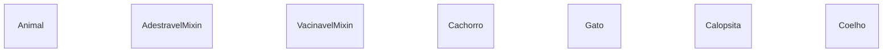

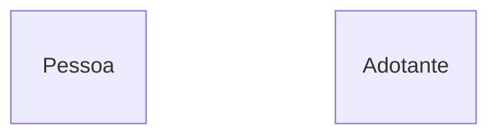

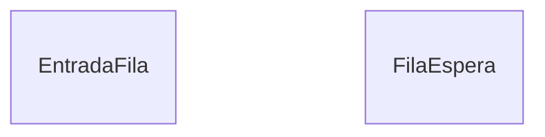

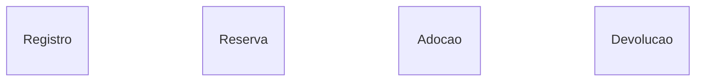

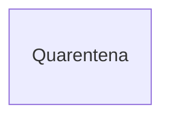

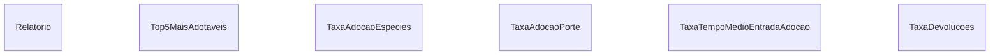

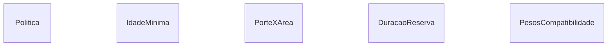

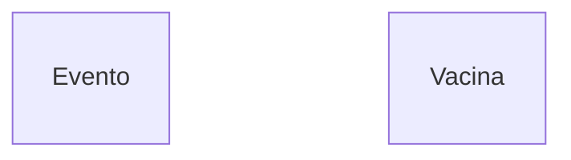

---

<br>
<br>

## 🧱 Decisões de design
As decisões de design tomadas ao longo do projeto visam alinhar tanto a experiência de desenvolvimento quanto os requisitos do trabalho, visando alcançar um bom desempenho.

### [click aqui para acessar](./docs/decisoes-de-design.md)

---

<br>
<br>

## 🎮 Funcionalidades:
```text
Seguindo a lógica dos endpoints da aplicação
```

O projeto implementa uma api via FastAPI, onde os endpoints foram baseados nas entidades de domínio da aplicação. Além disso, cada entidade possui seu arquivo de rotas e de schemas relacionados. Os schemas foram implementados com a utilização da biblioteca `pydantic` e visão realizar uma validação prévia sobre os dados enviados nas requisições, as quais são complementadas com as validações realizadas ao longo do fluxo `api -> service (+model) -> repository(+model)`.

> [!TIP]
> Ao todo, existem 7 entidades de domínio.   
> Totalizando `51` + a rota default endpoints

Cada uma das entidades de domínio possui as 4 operações de CRUD, mais endpoints adicionais relacionados as especificidades das entidades.

### Endpoints conforme entidades:
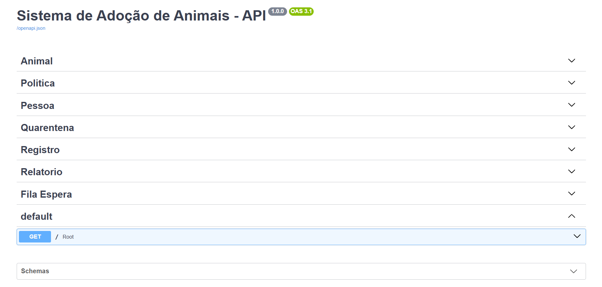

### Rotas por entidade:
|    Entidade     |  endpoints  |
| --------------  | ----------- |
| `Animal`        |  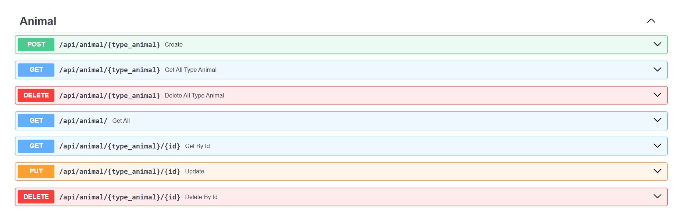 |  
| `Politica`      |  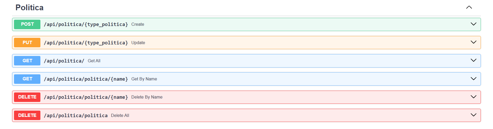 |  
| `Pessoa`        |  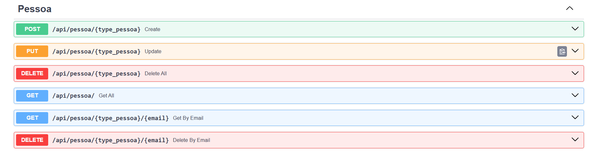 |  
| `Quarentena`    |  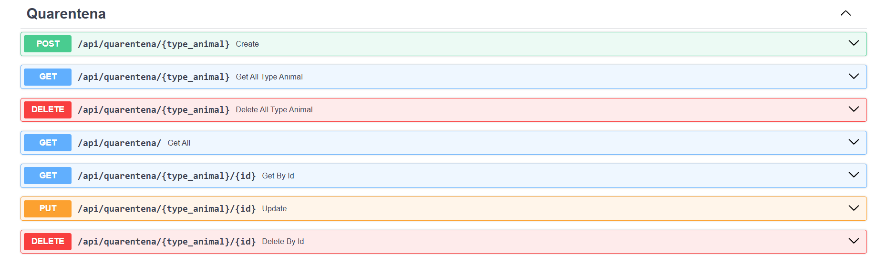 |  
| `Registro`      |  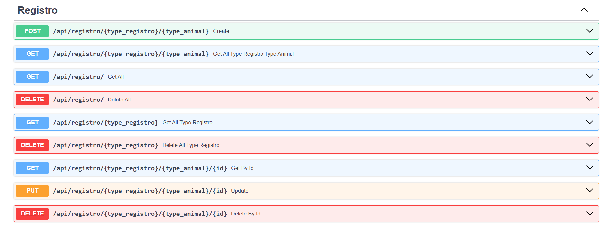 |  
| `Relatorio`     |  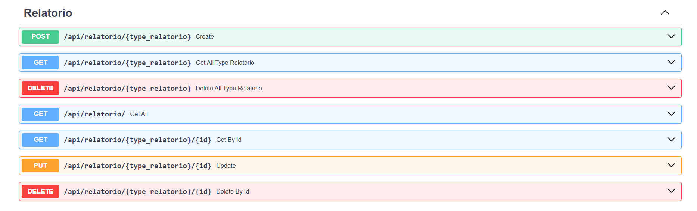 |  
| `Fila Espera`   |  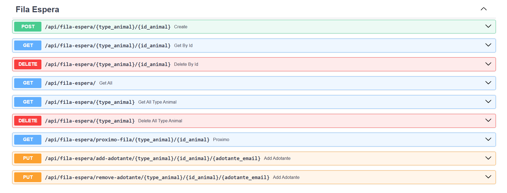 |  

---

<br>
<br>

## 🧩 Cobertura dos testes:
```text
A estrutura de pastas dos testes segue a estrutura de src
```
Testes unitários visando questões chave como criação de instâncias (casos de sucesso e falha) e reatividade à mudanças de propriedades. Também devem ser verificadas as exceções lançados em casos de verificação de falha.

> [!TIP]
> Contagem de testes atual: `376`

Para os testes envolvendo persistência de dados, arquivos json são criados na pasta `tests/data`

**Testes implementados em:**
- Models
- Repositories
- Services

### Em resumo:
- `Testes unitários`, `casos de sucesso (intancia)`, `casos de falha (instancia)`, `reaatividade à mudanças`

<br>

> [!NOTE]
> Testes gerados com auxílio de ia generativa foram devidamente declarados em seus respectivos arquivos.   
> Conforme a decisão de design **8**, códigos gerados com auxílio de ia também foram devidamente declarados.
