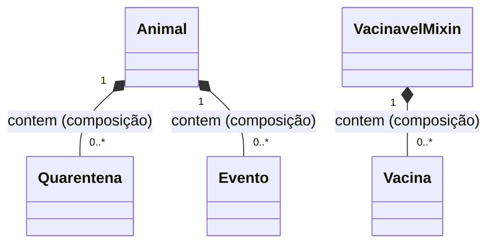
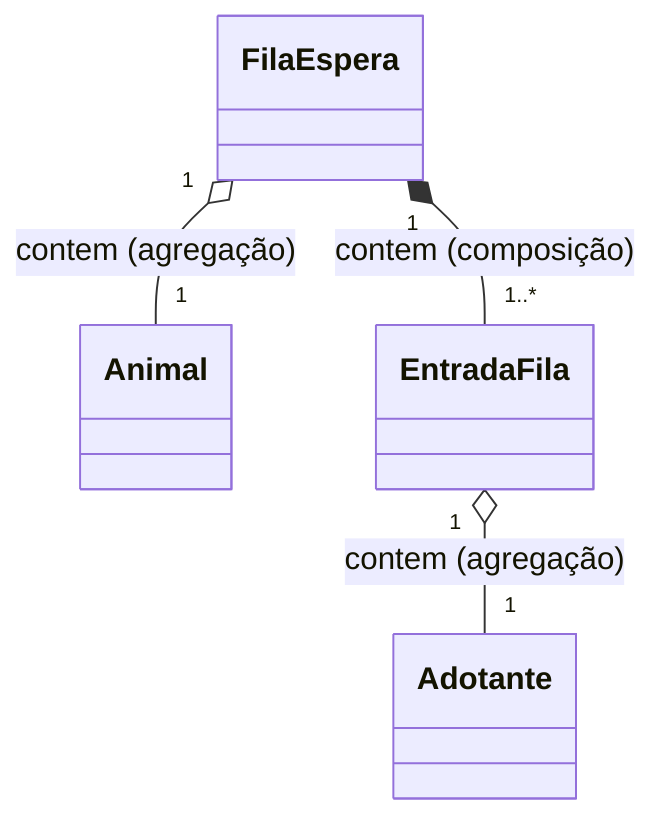
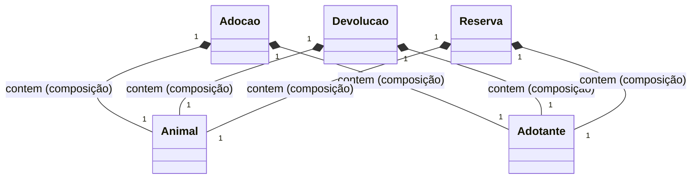
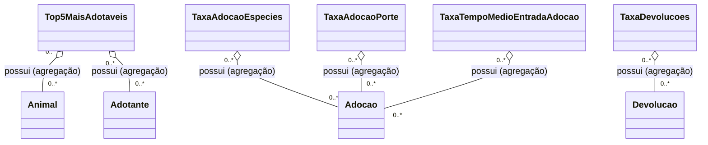

# 📄Modelagem das relações entre as classes
Aqui estão descritas os relacionamentos observados entre as classes do sistema (exceto para herança).

Atributos e métodos não foram representados para evitar poluição visual e excesso de detalhes.

- [Click para voltar ao uml](./uml.md)
- [Click para voltar ao readme](../README.md#-classes-planejadas)

### Sumário:
* [Animais](#animais);
* [Lista de Espera](#lista-de-espera);
* [Registros](#registros);
* [Relatórios](#relatórios);

 

---

### Animais:

 

---

### Lista de Espera:

 

---

### Registros

---

 

### Relatórios

 
