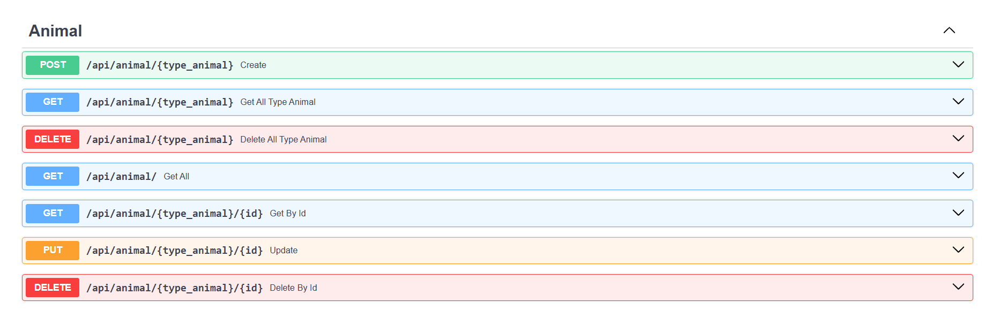
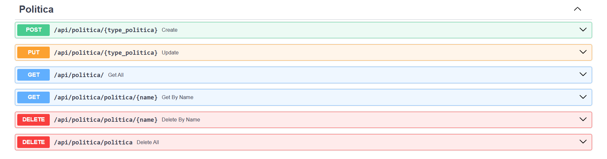
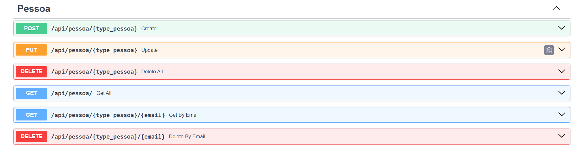
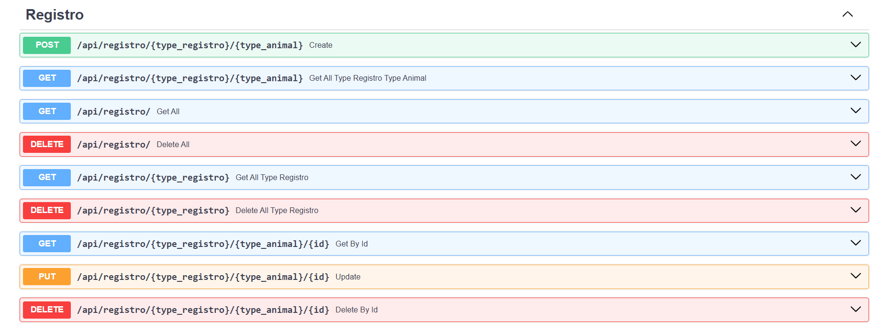
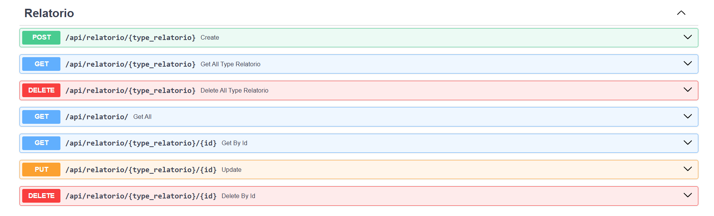
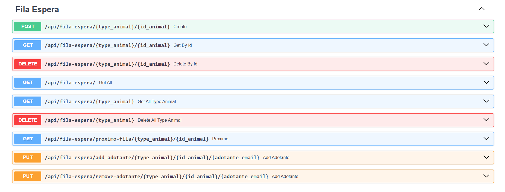

# 📖 Guia de uso com exemplos:

Este é um arquivo para guiar a utilização desta aplicação. Ele foi baseado na interface nativa acessada via /docs. Mas nada impede que você utilize outras opções de ferramentas como Insomnia e Postman.

Por questões de repetitividade de informações, este guia focará nos métodos POST, devido ao request body

Os demais métodos são intuitivos e seguem o mesmo padrão do que foi apresentado, completamente, em animal

**[Click para voltar ao Readme](../README.md#-como-começar)**

## 📌 Sumário:
- [Animal](#animal)
- [Politica](#️politica)
- [Pessoa](#pessoa)
- [Quarentena](#quarentena)
- [Registro](#registro)
- [Relatorio](#relatorio)
- [Fila Espera](#️fila-espera)

---

<br>
<br>

## 🐶Animal:


> [!TIP] POST - Create

Atenção, nenhum animal é cadastrado com eventos ou vacinas. Tentar isso levantará uma exceção.

Para cada animal, lembre de alterar o campo type_animal

Abaixo estão exemplos de como fornecer o Request Body para cada tipo de animal:

### Cachorro:
```
{
    "especie": "Canis lupus familiaris",
    "nome": "Campeão",
    "sexo": "MACHO",
    "idade_meses": 2,
    "porte": "P",
    "status": "DISPONIVEL",
    "energia": "CALMO",
    "cuidado_especial": false,
    "data_entrada": "2026-10-31 17:14:30.249506",
    "historico": [],
    "temperamento": [
        "DOCIL"
    ],
    "nivel_adestramento": 0,
    "vacinas": [],
    "raca": "Pastor Alemão",
    "passeios_necessarios_dia": 2
}
```

### Calopsita:
```
{
    "especie": "Nymphicus hollandicus",
    "nome": "Nuvem",
    "sexo": "FEMEA",
    "idade_meses": 4,
    "porte": "P",
    "status": "DISPONIVEL",
    "energia": "HIPERATIVO",
    "cuidado_especial": false,
    "data_entrada": "2026-10-30 14:07:28.818318",
    "historico": [],
    "temperamento": ["MEDROSO"],
    "nivel_adestramento": 1,
    "canta": true
}
```

### Coelho:
```
{
    "especie": "Oryctolagus cuniculus",
    "nome": "Perna longa",
    "sexo": "MACHO",
    "idade_meses": 27,
    "porte": "M",
    "status": "DISPONIVEL",
    "energia": "CALMO",
    "cuidado_especial": false,
    "data_entrada": "2026-10-30 14:07:28.818318",
    "historico": [],
    "temperamento": [],
    "nivel_adestramento": 3,
    "vacinas": [],
    "raca": "string",
    "tamanho_gaiola_m3": 1.0
}
```

### Gato:
```
{
    "especie": "Felis catus",
    "nome": "Tom",
    "sexo": "MACHO",
    "idade_meses": 38,
    "porte": "M",
    "status": "DISPONIVEL",
    "energia": "HIPERATIVO",
    "cuidado_especial": true,
    "data_entrada": "2026-10-30 14:07:28.818318",
    "historico": [],
    "temperamento": [
        "MEDROSO",
        "ARISCO"
    ],
    "nivel_adestramento": 1,
    "vacinas": [],
    "raca": "string",
    "independencia": false
}
```

<br>

> [!NOTE] GET - Get All Type Animal

Apenas selecione o tipo de animal e execute

> [!CAUTION] DELETE - Delete All Type Animal

Apenas selecione o tipo de animal e execute

> [!NOTE] GET - Get All

Apenas executa

> [!NOTE] GET - Get By Id

Informe o tipo do animal e o id buscado

> [!WARNING] PUT - Update

Informe o tipo do animal, o id e o Request Body (mesmo padrão que o Create)

Eventos e vacinas são adicionados aqui

```
{
  "especie": "Canidio",
  "nome": "Campeão Fil",
  "sexo": "MACHO",
  "idade_meses": 8,
  "porte": "P",
  "status": "DISPONIVEL",
  "energia": "CALMO",
  "cuidado_especial": false,
  "data_entrada": "2026-11-01T18:32:54.185103",
  "historico": [{ "tipo":"VACINA", "descricao": "vacina contra raiva", "data":"2026-11-01T18:32:54.185103"}],
  "temperamento": [],
  "nivel_adestramento": 3,
  "vacinas": [{"nome": "contra raiva", "data":"2026-11-01T18:32:54.185103"}],
  "raca": "golden",
  "passeios_necessarios_dia": 5,
  "id": 8
}
```

> [!CAUTION] DELETE - Delete By Id

Apenas informe o tipo do animal e o id

---

<br>

## ⚖️Politica


> [!TIP] POST - Create

Selecione o tipo de política e informe o Request Body

Atenção, tentar cadastrar a mesma política duas vezes levantará uma exceção

Abaixo, seguem exemplos de como preencher cada política.

Para funcionamento da aplicação, todas as políticas são preenchidas pelo seed

Deixar políticas não preenchidas poderá causar problemas à aplicação

### IdadeMinima:
```
{
  "nome": "Idade mínima de adotantes",
  "data_modificacao": "2026-11-01T23:39:54.738626",
  "idade_minima": 18
}
```

### DuracaoReserva
```
{
  "nome": "Duração máxima de reservas",
  "data_modificacao": "2026-11-01 23:13:21.171218",
  "duracao_dias": 15
}
```

### PesosCompatibilidade
```
{
  "nome": "Pesos dos fatores de compatibilidade",
  "data_modificacao": "2026-11-01 23:13:21.171218",
  "peso_porte_moradia": 0.2,
  "peso_experiencia_temperamento": 0.3,
  "peso_tempo_livre_energia": 0.2,
  "peso_criancas_temperamento": 0.3
}
```

### PorteXArea
```
{
    "nome": "Area mínima por porte",
    "data_modificacao": "2026-11-01 23:13:21.171218",
    "porte_p_min": 20,
    "porte_m_min": 40,
    "porte_g_min": 100
}
```

> [!WARNING] PUT - Update

Informe o tipo de política e o request body (igual ao reques body do Create)

---

<br>

## 👤Pessoa


> [!TIP] POST - Create

Exemplo presente na própria página /docs

---

<br>

## 🔒Quarentena


> [!TIP] POST - Create

Exemplo presente na própria página /docs

Forneça o animal correspondente ao tipo, ou isso levantará uma exceção

---

<br>

## 📃Registro


> [!TIP] POST - Create

### Adocao
```
{
  "animal": {
    "especie": "string",
    "nome": "string",
    "sexo": "MACHO",
    "idade_meses": 0,
    "porte": "P",
    "status": "DISPONIVEL",
    "energia": "CALMO",
    "cuidado_especial": true,
    "data_entrada": "2026-11-01T23:39:54.714807",
    "historico": [],
    "temperamento": [],
    "nivel_adestramento": 3,
    "vacinas": [],
    "raca": "string",
    "passeios_necessarios_dia": 0,
    "id": 0
  },
  "adotante": {
    "nome": "string",
    "email": "Xb5VbfuXEs7a7LxWvpu_69IgU@9B0gsAl5GaJbWk.jvPZGkj",
    "idade": 1,
    "moradia": "APARTAMENTO_COM_VARANDA",
    "experiencia": "INICIANTE",
    "tempo_livre_min": 0,
    "possui_criancas": true,
    "outros_animais": true,
    "area_util": 0
  },
  "pago": true,
  "data": "2026-11-02T03:58:22.357Z",
  "taxa": 0
}
```

### Devolucao
```
{
  "animal": {
    "especie": "string",
    "nome": "string",
    "sexo": "MACHO",
    "idade_meses": 0,
    "porte": "P",
    "status": "DISPONIVEL",
    "energia": "CALMO",
    "cuidado_especial": true,
    "data_entrada": "2026-11-01T23:39:54.714807",
    "historico": [],
    "temperamento": [],
    "nivel_adestramento": 3,
    "vacinas": [],
    "raca": "string",
    "passeios_necessarios_dia": 0,
    "id": 0
  },
  "adotante": {
    "nome": "string",
    "email": "Xb5VbfuXEs7a7LxWvpu_69IgU@9B0gsAl5GaJbWk.jvPZGkj",
    "idade": 1,
    "moradia": "APARTAMENTO_COM_VARANDA",
    "experiencia": "INICIANTE",
    "tempo_livre_min": 0,
    "possui_criancas": true,
    "outros_animais": true,
    "area_util": 0
  },
  "motivo": "COMPORTAMENTO" 
}
```

### Reserva
```
{
  "animal": {
    "especie": "string",
    "nome": "string",
    "sexo": "MACHO",
    "idade_meses": 0,
    "porte": "P",
    "status": "DISPONIVEL",
    "energia": "CALMO",
    "cuidado_especial": true,
    "data_entrada": "2026-11-01T23:39:54.714807",
    "historico": [],
    "temperamento": [],
    "nivel_adestramento": 3,
    "vacinas": [],
    "raca": "string",
    "passeios_necessarios_dia": 0,
    "id": 0
  },
  "adotante": {
    "nome": "string",
    "email": "Xb5VbfuXEs7a7LxWvpu_69IgU@9B0gsAl5GaJbWk.jvPZGkj",
    "idade": 1,
    "moradia": "APARTAMENTO_COM_VARANDA",
    "experiencia": "INICIANTE",
    "tempo_livre_min": 0,
    "possui_criancas": true,
    "outros_animais": true,
    "area_util": 0
  },
  "data_inicial": "2026-11-01T23:39:54.714807",
  "status": "ATIVA"
}
```

---

<br>

## 📔Relatorio:


> [!TIP] POST - Create

### Top5MaisAdotaveis:

Dica para preenchimento, execute o Get All dos animais que você quer considerar e o Get All de pessoas

```
{
  "data": "2026-11-02T04:12:09.571Z",
  "nome": "string",
  "animais": [
    {
      "especie": "string",
      "nome": "string",
      "sexo": "MACHO",
      "idade_meses": 0,
      "porte": "P",
      "status": "DISPONIVEL",
      "energia": "CALMO",
      "cuidado_especial": true,
      "data_entrada": "2026-11-01T23:39:54.714807",
      "historico": [],
      "temperamento": [],
      "nivel_adestramento": 3,
      "vacinas": [],
      "raca": "string",
      "passeios_necessarios_dia": 0,
      "id": 0
    },
    {
      "especie": "string",
      "nome": "string",
      "sexo": "MACHO",
      "idade_meses": 0,
      "porte": "P",
      "status": "DISPONIVEL",
      "energia": "CALMO",
      "cuidado_especial": true,
      "data_entrada": "2026-11-01T23:39:54.714807",
      "historico": [],
      "temperamento": [],
      "nivel_adestramento": 3,
      "canta": true,
      "id": 0
    },
    {
      "especie": "string",
      "nome": "string",
      "sexo": "MACHO",
      "idade_meses": 0,
      "porte": "P",
      "status": "DISPONIVEL",
      "energia": "CALMO",
      "cuidado_especial": true,
      "data_entrada": "2026-11-01T23:39:54.714807",
      "historico": [],
      "temperamento": [],
      "nivel_adestramento": 3,
      "vacinas": [],
      "raca": "string",
      "tamanho_gaiola_m3": 0.35,
      "id": 0
    },
    {
      "especie": "string",
      "nome": "string",
      "sexo": "MACHO",
      "idade_meses": 0,
      "porte": "P",
      "status": "DISPONIVEL",
      "energia": "CALMO",
      "cuidado_especial": true,
      "data_entrada": "2026-11-01T23:39:54.714807",
      "historico": [],
      "temperamento": [],
      "nivel_adestramento": 3,
      "vacinas": [],
      "raca": "string",
      "independencia": true,
      "id": 0
    }
  ],
  "adotantes": [
    {
      "nome": "string",
      "email": "VzWGz7yBCwTB@ACcGzB6jf5_VFNJ0vkQO5JmFrR68Z-yLrlrPQFG0hw_W4MXrHoAA.T3.RNz3i35IU6z0uEn2U1IjbPM9FKrDuwsKd4cEYDFeZaFqc8gWY4SuOfmMwdKo2Mi688MZWucLP10CAR9HY_tQsCisHMT",
      "idade": 1,
      "moradia": "APARTAMENTO_COM_VARANDA",
      "experiencia": "INICIANTE",
      "tempo_livre_min": 0,
      "possui_criancas": true,
      "outros_animais": true,
      "area_util": 0
    }
  ]
}
```

### TaxaAdocao

Preencha a lista de adocoes executando o get all type de registro

O mesmo schema de create serve para TaxaAdocaoEspecies, TaxaAdocaoPorte, TaxaTempoMedioEntradaAdocao

```
{
  "data": "2026-11-02T04:12:09.571Z",
  "nome": "string",
  "adocoes": []
}
```

### TaxaAdocao

Preencha a lista de adocoes e de devolucoes executando o get all type de registro

```
{
  "data": "2026-11-02T04:12:09.571Z",
  "nome": "string",
  "adocoes": [],
  "devolucoes": [],
}
```

> [!WARNING] PUT - Update

Dados externos ou gerados pelo próprio relatório não são atualizados, para manter a integridado quanto ao estado da aplicação em que o relatório foi gerado. (Os dados são passados no Request Body, mas não são considerados na hora de atualizar)

---

<br>

## 🗂️Fila Espera:


Request Body com exemplo completo e execução intuitiva via interface.
